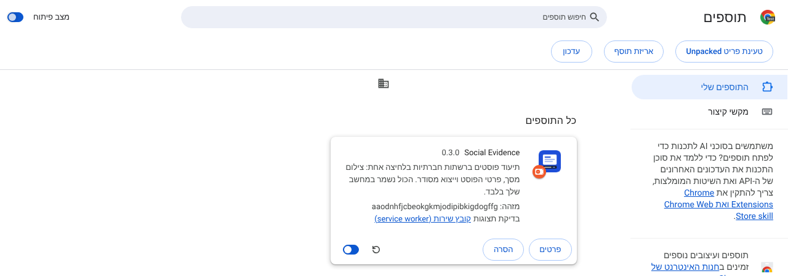
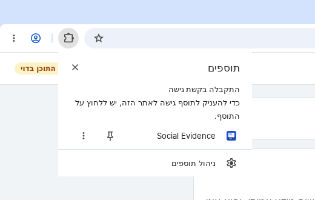
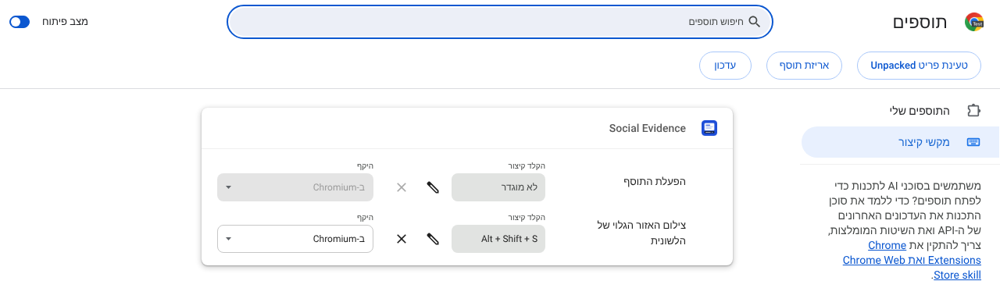
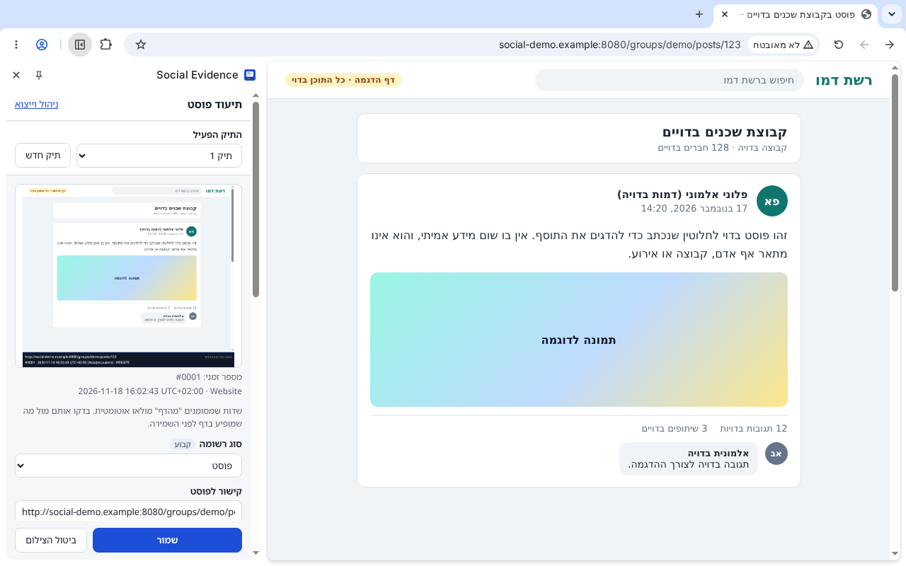
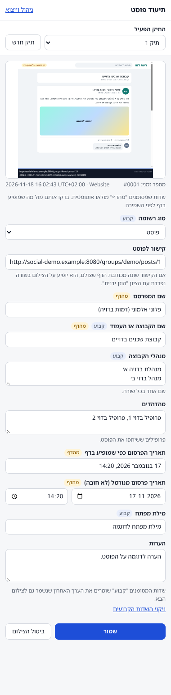
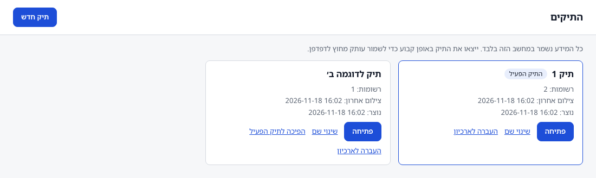
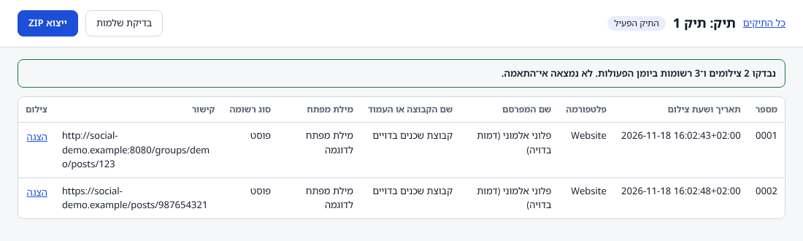
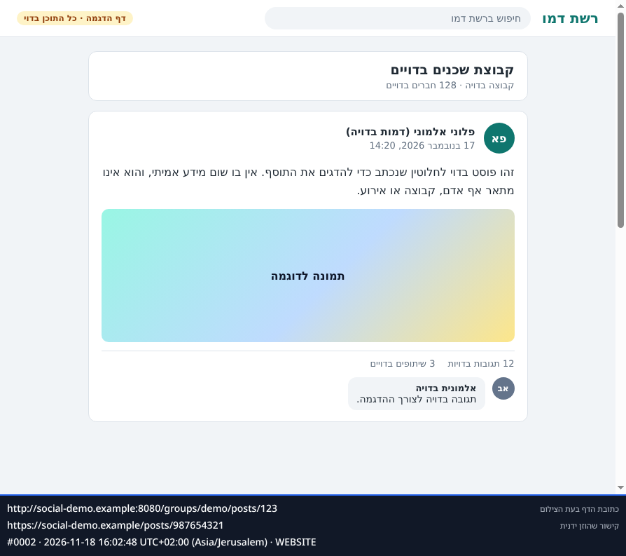

<div dir="rtl">

# Social Evidence – מדריך התקנה ושימוש

Social Evidence הוא תוסף ל‑Chrome שמתעד פוסטים ברשתות חברתיות ובאתרים רגילים. אתם גולשים ומחפשים בעצמכם, וכשמצאתם פוסט שחשוב לתעד, לחיצה אחת מצלמת את המסך, רושמת את הכתובת, התאריך והשעה, ופותחת טופס קצר לפרטי הפוסט. בסוף מייצאים את התיק כקובץ ZIP עם צילומים ממוספרים וטבלה תואמת.

המדריך מתאר את גרסה 0.3.0. בגרסה הזאת עדיין אי אפשר לערוך או למחוק רשומה אחרי ששמרתם אותה, ואין צילום של עמוד מלא בגלילה. שתי היכולות מתוכננות לגרסה הבאה.

**תוכן המדריך**

1. [מה התוסף עושה ומה הוא לא עושה](#1-מה-התוסף-עושה-ומה-הוא-לא-עושה)
2. [מה צריך](#2-מה-צריך)
3. [התקנה](#3-התקנה)
4. [תיעוד פוסט, שלב אחר שלב](#4-תיעוד-פוסט-שלב-אחר-שלב)
5. [תיקים](#5-תיקים)
6. [ייצוא התיק](#6-ייצוא-התיק)
7. [בדיקת שלמות](#7-בדיקת-שלמות)
8. [שמירה על המידע](#8-שמירה-על-המידע)
9. [עדכון לגרסה חדשה](#9-עדכון-לגרסה-חדשה)
10. [פרטיות, אבטחה ומגבלות](#10-פרטיות-אבטחה-ומגבלות)
11. [פתרון תקלות](#11-פתרון-תקלות)

## 1. מה התוסף עושה ומה הוא לא עושה

**עושה:**

- מצלם את החלק הגלוי של הלשונית בלחיצה אחת או בקיצור מקלדת.
- מוסיף מתחת לצילום פס מידע: כתובת הדף, תאריך ושעה עם אזור זמן, מספר רץ ושם הפלטפורמה.
- ממלא חלק מהפרטים מתוך הדף ומבקש מכם לבדוק אותם.
- שומר כל רשומה בתיק, עם מספור רץ נפרד לכל תיק.
- מייצא תיק כקובץ ZIP עם צילומים, טבלה לאקסל ורשימת חתימות (SHA-256) לאימות.

**לא עושה:**

- לא גולש, לא גולל ולא אוסף מידע בעצמו. הוא פועל רק כשאתם לוחצים, ורק על הלשונית שפתוחה מולכם.
- לא שולח שום דבר לשום מקום. הכול נשמר בדפדפן שלכם, במחשב שלכם.

## 2. מה צריך

- מחשב עם דפדפן Chrome בגרסה 116 ומעלה. התוסף לא פועל בטלפון.
- חשבון ברשת החברתית שבה אתם מתעדים, אם התוכן דורש התחברות. התוסף מצלם רק את מה שאתם רואים.

## 3. התקנה

התוסף אינו נמצא בחנות של Chrome. מתקינים אותו מקובץ שמורידים מ‑GitHub. ההתקנה נעשית פעם אחת ונמשכת כמה דקות.

### שלב 1: הורדה

1. פתחו את [דף הגרסה האחרונה](https://github.com/matnael332/Social-evidence/releases/latest).
2. תחת Assets הורידו את הקובץ ששמו `social-evidence-X.Y.Z.zip` (המספרים הם מספר הגרסה).

### שלב 2: חילוץ לתיקייה קבועה

1. חלצו את קובץ ה‑ZIP: ב‑Windows לחיצה ימנית על הקובץ ובחירה ב"חלץ הכול" (Extract All); ב‑Mac לחיצה כפולה על הקובץ.
2. העבירו את התיקייה שנוצרה למקום קבוע, למשל תיקיית המסמכים.

> **חשוב:** Chrome טוען את התוסף ישירות מהתיקייה הזאת. אל תמחקו אותה ואל תעבירו אותה למקום אחר אחרי ההתקנה. אם תטענו את התוסף מתיקייה אחרת, Chrome יתייחס אליו כאל תוסף חדש עם מאגר ריק.

### שלב 3: טעינה ב‑Chrome

1. הקלידו בשורת הכתובת `chrome://extensions` ולחצו Enter. ייפתח הדף "תוספים".
2. הפעילו את המתג **"מצב פיתוח"** (Developer mode) בפינת הדף.
3. לחצו על **"טעינת פריט Unpacked"** (Load unpacked).
4. בחרו את התיקייה שחילצתם. זו התיקייה שבתוכה נמצא הקובץ `manifest.json`.

התוסף Social Evidence יופיע ברשימה:



### שלב 4: הצמדת הסמל לסרגל הכלים

1. לחצו על סמל הפאזל ("תוספים") בסרגל הכלים של Chrome.
2. לחצו על סמל הנעץ ליד Social Evidence. סמל התוסף יישאר גלוי בסרגל.



ההודעה "התקבלה בקשת גישה" שמופיעה בתפריט היא תקינה: התוסף מקבל גישה לדף רק ברגע שאתם לוחצים עליו.

### שלב 5: בדיקת קיצור המקלדת

קיצור המקלדת לצילום הוא <kbd>Alt</kbd>+<kbd>Shift</kbd>+<kbd>S</kbd> (ב‑Mac: <kbd>Option</kbd>+<kbd>Shift</kbd>+<kbd>S</kbd>).

כדי לבדוק או לשנות אותו, פתחו בדף התוספים את **"מקשי קיצור"**, או הקלידו `chrome://extensions/shortcuts`. הקיצור מופיע בשורה "צילום האזור הגלוי של הלשונית":



אם השדה ריק, סימן שהקיצור תפוס על ידי תוסף אחר. לחצו על סמל העיפרון והקישו צירוף אחר.

### אימות הקובץ שהורדתם (לא חובה)

לצד קובץ ה‑ZIP מופיע בדף הגרסה קובץ `.sha256` עם החתימה שלו. כדי לוודא שהקובץ שהורדתם זהה לקובץ שנבנה ב‑GitHub, חשבו את החתימה והשוו:

Windows (PowerShell):

```powershell
Get-FileHash .\social-evidence-0.3.0.zip -Algorithm SHA256
```

Mac:

```bash
shasum -a 256 social-evidence-0.3.0.zip
```

Linux:

```bash
sha256sum -c social-evidence-0.3.0.zip.sha256
```

## 4. תיעוד פוסט, שלב אחר שלב

### שלב 1: פתחו את הפוסט בעמוד משלו

לפני הצילום, לחצו על התאריך או השעה של הפוסט. הפוסט ייפתח בעמוד נפרד, וכתובת הלשונית תהיה הקישור הישיר אליו.

זה הכלל החשוב ביותר בעבודה עם התוסף. הכתובת שמודפסת על הצילום היא כתובת הלשונית, והפרטים נקראים מהדף שפתוח. אם תצלמו מתוך פיד של קבוצה, תירשם כתובת הקבוצה ולא כתובת הפוסט.

### שלב 2: צלמו

לחצו על סמל התוסף בסרגל הכלים, או הקישו <kbd>Alt</kbd>+<kbd>Shift</kbd>+<kbd>S</kbd>.

חלונית צד נפתחת ליד הדף, עם הצילום ועם הטופס:



שני דברים שכדאי לדעת:

- **הצילום מראה את הדף כפי שהוא מוצג ליד החלונית.** בצילום הראשון החלונית נפתחת, הדף מתכווץ מעט, ורק אז המסך מצולם. השאירו את החלונית פתוחה בזמן העבודה, וכל צילום נוסף יהיה מיידי.
- **מצולם רק מה שרואים על המסך.** אם הפוסט ארוך, גללו כך שהחלק החשוב ייראה, וצלמו שוב לרשומה נוספת במידת הצורך.

### שלב 3: בדקו והשלימו את הפרטים



| שדה | מה ממלאים |
|---|---|
| **סוג רשומה** | פוסט, עמוד מנהלי קבוצה, פרופיל או אחר |
| **קישור לפוסט** | ממולא בכתובת הדף. אפשר להחליף בקישור הישיר לפוסט |
| **שם המפרסם** | מי פרסם את הפוסט |
| **שם הקבוצה או העמוד** | היכן הפוסט פורסם |
| **מנהלי הקבוצה** | שם אחד בכל שורה |
| **מהדהדים** | פרופילים ששיתפו את הפוסט |
| **תאריך הפרסום כפי שמופיע בדף** | בדיוק כפי שכתוב, למשל "אתמול ב־14:20" |
| **תאריך פרסום מנורמל (לא חובה)** | תאריך ושעה מדויקים, אם ידועים |
| **מילת מפתח** | המילה שבזכותה מצאתם את הפוסט |
| **הערות** | טקסט חופשי |

**התג "מהדף":** שדה שמסומן כך מולא אוטומטית מתוך הדף. בדקו אותו מול מה שמופיע בדף ותקנו אם צריך. ברגע שתערכו את השדה, התג ייעלם.

**התג "קבוע":** סוג הרשומה, שם הקבוצה, מנהלי הקבוצה ומילת המפתח שומרים את הערך האחרון שנשמר גם לצילום הבא. כך לא צריך להקליד אותם מחדש כשמתעדים כמה פוסטים מאותה קבוצה. הקישור "ניקוי השדות הקבועים" בתחתית הטופס מרוקן אותם.

**אזהרת כתובת:** אם סוג הרשומה הוא "פוסט" והכתובת אינה של פוסט בודד בפייסבוק, בטיקטוק או באינסטגרם, הטופס מציג אזהרה ומזכיר לפתוח את הפוסט בעמוד משלו. האזהרה אינה חוסמת את השמירה.

**קישור שהוזן ידנית:** אם תשנו את השדה "קישור לפוסט", הקישור החדש יופיע על הצילום בשורה נפרדת עם הציון "קישור שהוזן ידנית". השורה הראשונה על הצילום היא תמיד הכתובת שהייתה ללשונית בפועל.

### שלב 4: שמרו

לחצו **"שמור"**. תופיע ההודעה "נשמר #0001" עם המספר שהרשומה קיבלה.

בדקו את הפרטים לפני השמירה: בגרסה הזאת אי אפשר לתקן רשומה אחרי שנשמרה.

- "מספר זמני" שמופיע מתחת לתצוגה המקדימה הוא המספר שהרשומה צפויה לקבל. המספר הסופי נקבע ברגע השמירה.
- **"ביטול הצילום"** מוחק את הצילום בלי לשמור. צילום שבוטל לא תופס מספר.
- אם תצלמו שוב לפני ששמרתם, התוסף ישאל אם להחליף את הצילום הקודם.

## 5. תיקים

כל רשומה נשמרת בתיק. לכל תיק יש מספור רץ משלו, שמתחיל ב‑0001.

**בחלונית הצד:**

- **"התיק הפעיל"** הוא התיק שאליו נשמרים הצילומים החדשים. בוחרים אותו מהרשימה.
- **"תיק חדש"** יוצר תיק ומיד הופך אותו לפעיל.
- השדות הקבועים נשמרים לכל תיק בנפרד.

**בדף התיקים:** לחצו "ניהול וייצוא" בחלונית הצד.



בכל כרטיס:

- **"פתיחה"** מציגה את הרשומות של התיק.
- **"שינוי שם"** משנה את שם התיק. השינוי נרשם ביומן הפעולות.
- **"הפיכה לתיק הפעיל"** מפנה אליו את הצילומים הבאים.
- **"העברה לארכיון"** מסתירה את התיק מרשימת הבחירה, בלי למחוק דבר. אי אפשר להעביר לארכיון את התיק הפעיל.

## 6. ייצוא התיק

1. בדף התיקים לחצו "פתיחה" על התיק.
2. לחצו **"ייצוא ZIP"**. הקובץ יורד לתיקיית ההורדות, בשם שמורכב משם התיק ומהתאריך.



### מה יש בקובץ

| קובץ | תוכן |
|---|---|
| `images/0001.png` … | הצילומים. שם הקובץ הוא המספר הרץ של הרשומה |
| `records.csv` | טבלת הרשומות. נפתחת באקסל עם עברית תקינה |
| `records.xlsx` | אותה טבלה בפורמט אקסל, מימין לשמאל |
| `deleted.csv` | רשומות שנמחקו: מספר, מועד המחיקה וחתימת הצילום |
| `audit-log.csv` | יומן הפעולות של התיק |
| `README.txt` | הסבר על הקבצים, על האימות ועל המגבלות |
| `hashes.txt` | חתימת SHA-256 של כל קובץ אחר בארכיון |

כך נראה צילום מיוצא. הפס הכהה בתחתית נוסף מתחת לצילום ואינו מכסה שום חלק מהדף:



### העמודות בטבלה

מספר, תאריך ושעת צילום, תאריך הפרסום, תאריך הפרסום (מנורמל), פלטפורמה, קישור, שם המפרסם, מהדהדים, שם הקבוצה או העמוד, מנהלי הקבוצה, מילת מפתח, סוג רשומה, הערות, שם הקובץ ו‑SHA-256.

המספר בעמודה הראשונה תואם לשם קובץ הצילום.

### אימות הקבצים

החתימות ב‑`hashes.txt` מאפשרות להראות שהקבצים לא השתנו מאז הייצוא.

Linux, בתיקייה שחולצה:

```bash
sha256sum -c hashes.txt
```

Mac:

```bash
shasum -a 256 -c hashes.txt
```

Windows (PowerShell), לקובץ בודד, ואז להשוות לשורה המתאימה ב‑`hashes.txt`:

```powershell
Get-FileHash .\images\0001.png -Algorithm SHA256
```

## 7. בדיקת שלמות

הכפתור **"בדיקת שלמות"** בתצוגת התיק בודק את המידע השמור בדפדפן:

- שכל צילום עדיין תואם לחתימה שחושבה בעת הצילום.
- שכל רשומה מופיעה ביומן הפעולות.
- שיומן הפעולות עצמו לא שונה.

תוצאה תקינה נראית כך: "נבדקו 2 צילומים ו־3 רשומות ביומן הפעולות. לא נמצאה אי־התאמה."

אם נמצאה אי־התאמה, ההודעה מפרטת באילו רשומות. במקרה כזה אל תסתמכו על הרשומות האלה בלי לברר מה קרה.

## 8. שמירה על המידע

המידע נשמר רק בדפדפן שבו התקנתם את התוסף. אין עותק בענן.

**מה מוחק את המידע:**

- הסרת התוסף מ‑Chrome (הכפתור "הסרה" בדף התוספים).
- מחיקת נתוני הגלישה של הפרופיל, או מחיקת הפרופיל עצמו.

**מה לא מוחק את המידע:** סגירת הדפדפן וכיבוי המחשב.

**המלצות:**

- ייצאו את התיק באופן קבוע, ובוודאי בסוף כל יום עבודה.
- שמרו עותק של קובצי הייצוא מחוץ למחשב, למשל בכונן חיצוני.
- שמרו את הקובץ `hashes.txt` יחד עם הארכיון. לחתימות יש ערך רק אם עותק שלהן נשמר במקום אחר.

## 9. עדכון לגרסה חדשה

1. **ייצאו קודם את כל התיקים.**
2. הורידו את קובץ ה‑ZIP של הגרסה החדשה וחלצו אותו.
3. העתיקו את הקבצים החדשים **לתוך אותה תיקייה** שממנה התוסף נטען, והחליפו את הקבצים הקיימים.
4. בדף התוספים לחצו על סמל הטעינה מחדש (החץ המעגלי) בכרטיס של Social Evidence.

> **אל תסירו את התוסף כדי לעדכן אותו, ואל תטענו אותו מתיקייה אחרת.** הסרה מוחקת את כל התיקים. טעינה מתיקייה אחרת יוצרת תוסף נפרד עם מאגר ריק, והתיקים הקיימים נשארים אצל התוסף הישן.

## 10. פרטיות, אבטחה ומגבלות

- **שום דבר לא יוצא מהדפדפן.** לתוסף אין שרת, והדפדפן עצמו חוסם כל ניסיון שלו לשלוח בקשה החוצה.
- **המידע במחשב אינו מוצפן.** מי שיש לו גישה לחשבון שלכם במחשב יכול לראות ולשנות את התיקים. מומלץ להשתמש בהצפנת דיסק ובפרופיל Chrome נפרד לעבודה הזאת.
- **התקינו רק קובץ שהורדתם מהדף הרשמי.** עותק שעבר שינוי יכול לפעול בשמכם בדף שאתם מצלמים.
- **הצילומים עשויים לכלול מידע אישי של אנשים אחרים.** האחריות לאיסוף ולשמירה כדין היא שלכם. התוסף אינו מטשטש דבר.
- **התאריך והשעה נלקחים משעון המחשב.** גורם חיצוני אינו מאמת אותם.
- **חתימת SHA-256 מראה שקובץ לא השתנה מאז שחושבה.** היא אינה מוכיחה מה הוצג בדף.
- **מילוי אוטומטי מהדף:** באתרים רגילים הוא מבוסס על מידע תקני שהאתר מפרסם. בפייסבוק, בטיקטוק ובאינסטגרם הוא ניסיון בלבד, שטרם נבדק מול האתרים עצמם. התייחסו לכל ערך שמסומן "מהדף" כאל הצעה שצריך לאשר.
- **התוסף אינו ייעוץ משפטי ואינו מבטיח קבילות.** אם החומר מיועד לתלונה או להליך משפטי, התייעצו עם עורך דין על אופן האיסוף והשמירה.

פירוט נוסף, באנגלית: [SECURITY.md](../SECURITY.md).

## 11. פתרון תקלות

**קיצור המקלדת לא עושה כלום.**
פתחו את `chrome://extensions/shortcuts` ובדקו שבשורה "צילום האזור הגלוי של הלשונית" מופיע צירוף מקשים. אם השדה ריק או שהצירוף מתנגש בתוכנה אחרת, בחרו צירוף אחר. אפשר תמיד לצלם בלחיצה על סמל התוסף.

**בזמן הטעינה מופיעה שגיאה שקובץ המניפסט חסר.**
נבחרה תיקייה לא נכונה. בחרו את התיקייה שבתוכה נמצא הקובץ `manifest.json` עצמו, ולא את התיקייה שמעליה.

**"אי אפשר לצלם את הדף הזה."**
התוסף מצלם רק דפי אינטרנט רגילים. הוא אינו יכול לצלם דפים פנימיים של Chrome (כמו דף התוספים) או קבצים מקומיים.

**"הצילום נכשל. נסו שוב."**
המתינו שנייה ולחצו שוב. אם זה חוזר, רעננו את הדף וצלמו שוב. אם זה חוזר רק בדף מסוים, ייתכן ש‑Chrome אינו מאפשר לתוספים לגשת אליו.

**הצילום צר מהמסך.**
זו ההתנהגות הצפויה: הצילום מראה את הדף כפי שהוא מוצג ליד חלונית הצד. הרחבת חלון הדפדפן תרחיב גם את הצילום.

**השדות לא מתמלאים אוטומטית, או מתמלאים בערך שגוי.**
המילוי האוטומטי הוא ניסיון בלבד, במיוחד ברשתות החברתיות. הקלידו או תקנו את הערך ידנית. הצילום עצמו אינו מושפע מכך.

**התוסף נעלם או שהתיקים ריקים.**
בדקו בדף התוספים שהתוסף עדיין טעון מאותה תיקייה שממנה התקנתם אותו. אם התיקייה הועברה או נמחקה, החזירו אותה למקומה המקורי וטענו מחדש. אם התוסף הוסר, התיקים נמחקו ואפשר לשחזר רק מקובצי ייצוא.

**אקסל מציג סימנים משובשים במקום עברית.**
פתחו את `records.xlsx` במקום את `records.csv`.

</div>
